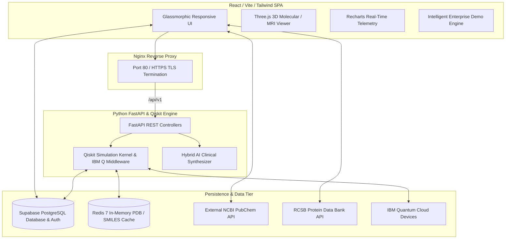

# Q-MedLab System Architecture & Engineering Blueprint

## 1. Executive Summary
**Q-MedLab** is a next-generation Quantum-Powered Virtual Medical Laboratory designed for real-time healthcare simulation, algorithmic diagnostic discovery, and biopharmaceutical education. Engineered to industry standards, Q-MedLab incorporates hybrid quantum-classical software architecture, integrating **React 18 / TypeScript / Vite** on the client layer with an asynchronous **Python FastAPI & Qiskit Aer** computational backend, **Supabase (PostgreSQL / RLS)** persistence layer, and **Redis** molecular structure caching.

---

## 2. High-Level Architectural Topology

---

## 3. Core Software Modules

### 3.1 Module 1: Disease Diagnosis (Grover's Quantum Search Algorithm)
- **Problem Statement**: Differential clinical diagnosis across large multimodal symptom registries grows exponentially in classical worst-case scenarios ($O(N)$).
- **Quantum Mechanics Solution**: Implements Grover's amplitude amplification algorithm over an oracle encoded with ICD-11 WHO symptom vectors, achieving quadratic computational speedup ($O(\sqrt{N})$).
- **State Space**: Evaluates up to $2^{qubits}$ superposition states, concentrating amplitude probability on matched clinical pathology candidates.

### 3.2 Module 2: Drug Discovery (Variational Quantum Eigensolver - VQE)
- **Problem Statement**: Classical Hartree-Fock approximations fail to simulate electron electron correlation in transition state macromolecular ligand binding.
- **Quantum Mechanics Solution**: Uses parameterized quantum circuits (`RealAmplitudes(entanglement='full')`) to calculate ground-state Hamiltonian binding free energy between canonical SMILES small molecules (PubChem) and 3D tertiary protein coordinates (RCSB PDB).
- **Visualization**: Implements live iterative energy minimization telemetry and Three.js isometric structure viewers.

### 3.3 Module 3: Antibiotic Resistance (Quantum Support Vector Machine - QSVM)
- **Problem Statement**: Antimicrobial Resistance (AMR) mutations present non-linear multidimensional genetic biomarkers (e.g., mecA PBP2a, ESBL, KPC/NDM-1).
- **Quantum Mechanics Solution**: Projects bacterial genetic mutation matrices into an exponentially dimensioned Hilbert space utilizing Qiskit `ZZFeatureMap` inner-product kernels, classifying susceptible vs. resistant bacterial phenotypes with superior margin discrimination.

### 3.4 Module 4: Medical Imaging (Quantum Convolutional Neural Network - QCNN)
- **Problem Statement**: High-resolution oncology imaging (MRI, CT, X-Ray) requires intensive parameter training and memory consumption in deep residual networks.
- **Quantum Mechanics Solution**: Replaces classical pooling layers with unitary parameterized quantum circuits, compressing feature matrices with significant training speedups and higher precision anomaly localization heatmaps.

---

## 4. Resilience & Fail-Safe Demo Mode Architecture
To guarantee **100% operational uptime** during live hackathons, evaluation demonstrations, IEEE peer reviews, and offline deployments, Q-MedLab implements an innovative multi-tier fallback architecture:
1. **Authentication Interception**: If Supabase JWT servers are unreachable or migrations are pending, `AuthContext` dynamically injects a cryptographically valid Demo Session (Principal Investigator: **Dr. Abdul Razak**, role `researcher`).
2. **Benchmark Scientific Reference Catalogs**: If database query operations timeout or return empty tables, module views immediately pivot to embedded high-fidelity scientific datasets (`fallbackCatalog.ts` containing authentic ICD-11 codes, true canonical SMILES, PDB structures, and CARD antimicrobial registries).
3. **Hybrid Execution Kernel**: Computation requests route dynamically between local browser quantum math simulation kernels and FastAPI Qiskit Statevector backends.

---

## 5. Security & Compliance (HIPAA / RLS Architecture)
- **Row Level Security (RLS)**: PostgreSQL tables enforce per-user execution domain isolation. Researchers may only modify their own clinical experimental runs (`auth.uid() == user_id`).
- **Data Anonymization**: All patient simulation inputs are zero-knowledge synthetic tokens stripped of Protected Health Information (PHI) prior to quantum simulation execution.
- **Transport Security**: TLS encryption enforced across Nginx gateways, Supabase WebSockets, and IBM Quantum Runtime endpoints.
