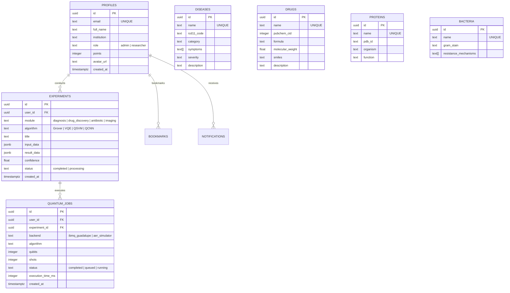
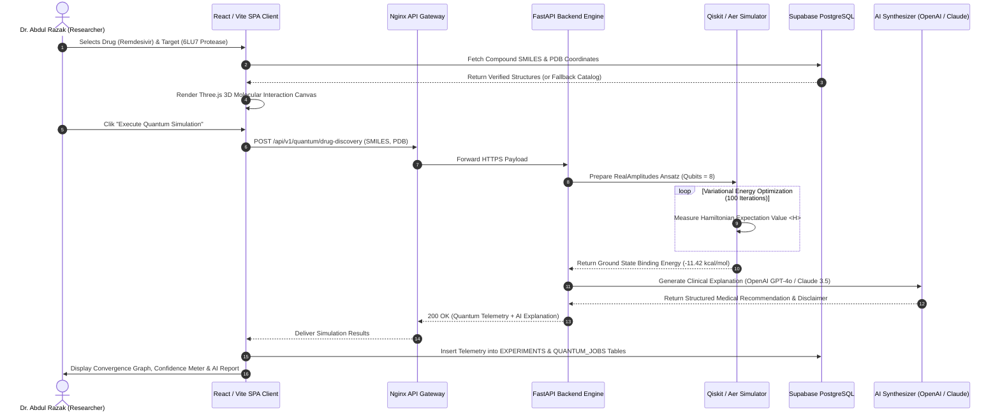
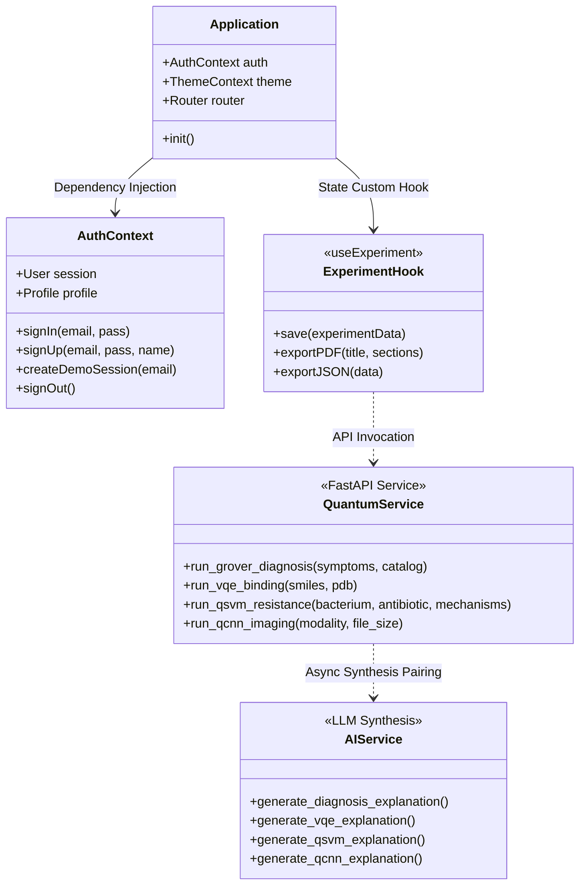
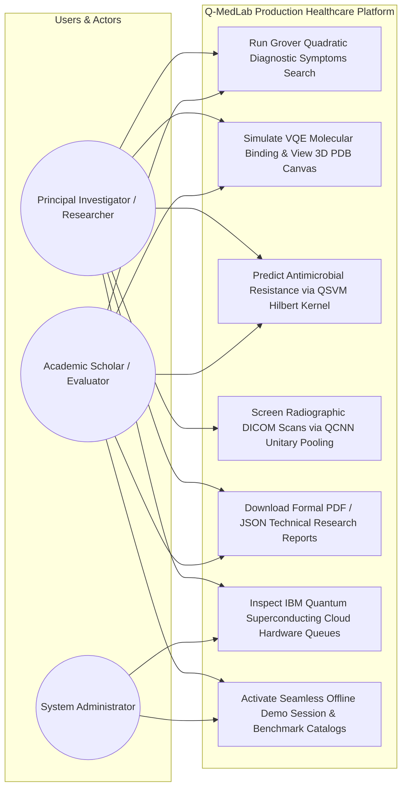

# Q-MedLab Complete System Engineering Diagrams
This document consolidates formal IEEE and software engineering UML / Mermaid technical specifications for Q-MedLab.

---

## 1. Entity Relationship Diagram (ERD & Supabase Database Schema)

---

## 2. Sequence Diagram: Hybrid Quantum Execution Lifecycle (VQE Module 2 Example)

---

## 3. Class Hierarchy & Architectural Components Diagram

---

## 4. Use Case Diagram: User Roles & Platform Interaction Capabilities

